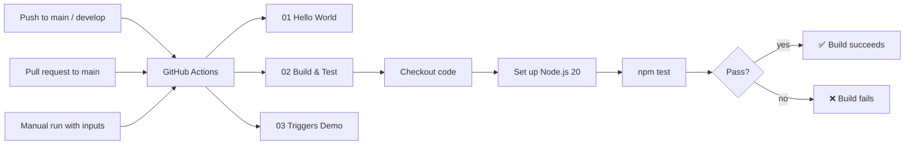

# 🚀 Pipeline Training: CI/CD with GitHub Actions

[](https://github.com/vijaydevops678/pipeline-training-/actions/workflows/01-hello-world.yaml)
[](https://github.com/vijaydevops678/pipeline-training-/actions/workflows/02-build-and-test.yaml)
[](https://github.com/vijaydevops678/pipeline-training-/actions/workflows/03-triggers-demo.yml)

A small Node.js web service used to learn and demonstrate **GitHub Actions** step by step: from a first "hello world" workflow, to an automated build-and-test pipeline, to workflows driven by different triggers and manual inputs.

## 🏗️ How it works



## ⚙️ Pipelines

| Workflow | Runs on | What it does |
|---|---|---|
| [01 - Hello World](.github/workflows/01-hello-world.yaml) | Push to `main`, manual | Prints runner details (OS, disk, memory) and GitHub context, creates a file on the runner |
| [02 - Build and Test](.github/workflows/02-build-and-test.yaml) | Push to `main`, manual | Checks out the code, sets up Node.js 20, runs the test suite |
| [03 - Triggers Demo](.github/workflows/03-triggers-demo.yml) | Push to `main`/`develop`, PR to `main`, manual | Detects how it was triggered; manual runs take inputs (environment choice, debug flag, custom message) |

## 🖥️ The app

A plain Node.js HTTP server (no dependencies).

| Endpoint | Response |
|---|---|
| `GET /` | Message, version, timestamp, environment |
| `GET /health` | `{"status": "healthy"}` for health checks |

Configuration through environment variables: `PORT` (default `3000`), `APP_VERSION` (default `1.0.0`), `NODE_ENV` (default `development`).

## ▶️ Run it locally

```bash
npm start                              # starts the server on port 3000
curl http://localhost:3000/health      # {"status":"healthy"}
npm test                               # runs the same tests as the pipeline
```

## 📁 Project structure

```
.
├── .github/workflows/
│   ├── 01-hello-world.yaml
│   ├── 02-build-and-test.yaml
│   └── 03-triggers-demo.yml
├── app.js          # HTTP server with / and /health
├── test.js         # tests run by the pipeline
├── index.html      # simple status page
└── package.json
```

## 📚 What I learned

- The anatomy of a workflow: `on` (triggers), `jobs`, `runs-on`, `steps`
- Using marketplace actions: `actions/checkout` and `actions/setup-node`
- Triggering pipelines by push, pull request and manual `workflow_dispatch` with typed inputs
- Running steps conditionally with `if: github.event_name == ...`
- Passing user inputs to scripts through `env:` instead of inline `${{ }}`, which protects the pipeline from script injection
- Failing a pipeline correctly with non-zero exit codes

## 🛣️ Next steps

- [ ] Build a Docker image and push it to GitHub Container Registry
- [ ] Add linting and security scanning (`npm audit`, Trivy)
- [ ] Test across several Node.js versions with a matrix build
- [ ] Deploy automatically to a cloud environment after tests pass
